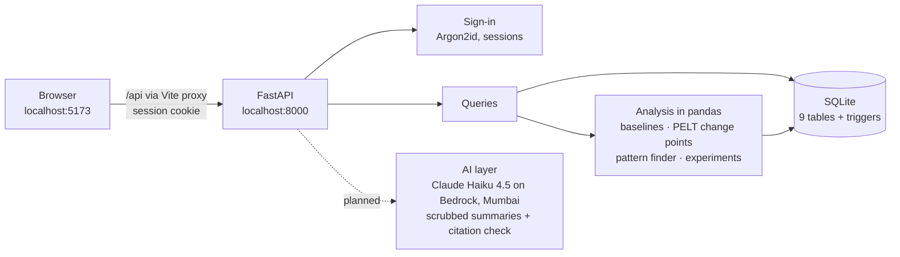

# RootTrace: Git for Your Body

RootTrace turns wearable and phone health logs into honest, testable experiments on yourself. Python finds real changes in your data and decides every result. An AI only explains, and every claim it makes must cite real record IDs.

> [!IMPORTANT]
> **This is a hackathon demo (wHACKiest 2026), not a finished product.**
> - **All health data in the demo is made up.** It is generated from a fixed random seed (`seed=42`) for one demo user over 90 days (25 Aug – 22 Nov 2026). No real person's data is in this repo.
> - Device names such as "iPhone 15 Pro" and file names such as `apple_health_export.xml` are part of the generated story.
> - It runs on your own computer only. There is one demo login and no cloud hosting.
> - **Not medical advice.** RootTrace never diagnoses or suggests medicines. It shows personal patterns to test.

---

## Contents

- [What it does](#what-it-does)
- [The demo story](#the-demo-story)
- [Run it locally](#run-it-locally)
- [Try the demo](#try-the-demo)
- [What works and what doesn't yet](#what-works-and-what-doesnt-yet)
- [How it works](#how-it-works)
- [API](#api)
- [Using your own Apple Health data (optional)](#using-your-own-apple-health-data-optional)
- [Rules that keep it honest](#rules-that-keep-it-honest)
- [Project layout](#project-layout)
- [Tests](#tests)
- [Team](#team)
- [Hackathon timeline](#hackathon-timeline)

---

## What it does

Most health apps show charts, and chatbots guess. RootTrace works like version control for your health questions:

1. **Trunk: your normal.** Daily sleep, steps, water, late screen time, caffeine and symptoms form a timeline. Python works out your personal 30-day normal (median and MAD).
2. **Change events: something shifted.** Change-point detection (`ruptures` PELT plus a median/MAD rule) marks the day a metric really moved, not just a noisy night.
3. **Branches: a question.** "Why do I keep getting headaches?" opens a branch with 2–3 competing explanations. Each one is scored from your own records, for example "4 of 5 headache days followed nights under 6 hours, but only 1 of 5 headache-free days did".
4. **Experiments: a fair test.** You pick an explanation and a test. The success rule is **locked in the database before day 1**, so nobody can move the goalposts later.
5. **Knowledge: the lesson.** When the test ends, Python decides the result against the locked rule. The lesson becomes a knowledge node on your timeline.

Every number links back to the raw record behind it (value, time, device, source file).

## The demo story

The generated data is built to tell this story, and every screen shows it:

| When | What happens |
|---|---|
| **Aug – Oct** | Normal life. An earlier investigation is already solved: **"Caffeine after 4 PM cuts my sleep by about 30 min"** (14-day experiment, supported). |
| **3 Nov** | Sleep drops **47 minutes** (from a normal of 7h 06m to 6h 19m) and stays low, while late-night screen time rises. |
| **7 Nov** | Branch: **"Why do I keep getting headaches?"** with 3 ranked explanations: short sleep (60%), low water (40%), screen light before bed (20%). One headache after a good night is kept as an honest counterexample. |
| **12–13 Nov** | Experiment locked: **lights out by 11:30 PM** for 10 nights. Rule: sleep over 7 hours on at least 7 of 10 nights. |
| **20 Nov** | The demo starts here: night 8 of 10, 88% adherence. |
| **+10 days** | Press the demo-clock button. Python decides the result: **supported**. Sleep stayed over 7 hours on 8 of 10 nights, and headache days fell from 5 to 0. |

## Run it locally

You need **Python 3.12** and **Node.js 18 or newer**.

> [!NOTE]
> Use Python 3.12, not 3.14: the change-detection library `ruptures` has no 3.14 build yet.

Open two terminals, both in the repo root.

**Terminal 1: backend (data and analysis), http://localhost:8000**

```bash
# Windows (PowerShell)
py -3.12 -m venv .venv
.venv\Scripts\activate
pip install -r requirements.txt
uvicorn backend.main:app --reload --port 8000
```

```bash
# macOS / Linux
python3.12 -m venv .venv
source .venv/bin/activate
pip install -r requirements.txt
uvicorn backend.main:app --reload --port 8000
```

> [!NOTE]
> Always run Uvicorn with a single worker (`--workers 1`, the default) because `DemoStore.clock` and `LoginRateLimiter` live in process memory.
> If you host the frontend on Vercel (`frontend/vercel.json` handles SPA routing to `/index.html`) separately from the backend, add an `/api/:path*` rewrite in `frontend/vercel.json` pointing to your backend URL so the `HttpOnly`, `SameSite=Lax` session cookie stays same-origin.

**Terminal 2: website, http://localhost:5173**

```bash
cd frontend
npm install
npm run dev
```

Open **http://localhost:5173**. Always use port 5173, not 8000: the website forwards `/api` calls to the backend, and that is how the sign-in cookie works.

The demo database is rebuilt from the seed the first time the backend is used, so every run starts from the same 20 Nov state. Fonts are bundled with the app, so it looks the same offline or on weak Wi-Fi.

## Try the demo

1. On the landing page, click **Explore Judge Demo →**. It signs you in as the demo user, no password needed.
2. **Dashboard:** the timeline trunk with the 3 Nov sleep drop (red dot), the solved caffeine branch and the open headache branch. Click any node or record chip (like `sl_0071`) to see the raw record.
3. **Investigations:** the three explanations, the counts behind them, and the locked experiment.
4. **Insights:** sleep against your normal range, sleep vs water, weekly screen time, evidence strength per explanation, and the experiment night by night.
5. **History:** replay the whole timeline step by step with the → arrow key.
6. **Demo clock:** press **+10 Days → Conclude** to finish the experiment and watch the branch turn into knowledge. Press **Reset** to go back to 20 Nov.

You can also create your own account with **New User**. Passwords are hashed with Argon2id, and you see the same demo data.

## What works and what doesn't yet

| Area | Status |
|---|---|
| Landing page, sign-in, demo login | ✅ Works |
| Timeline graph, branches, change events, knowledge | ✅ Works, on live backend data |
| Investigation panel, experiment lock (database trigger), demo clock | ✅ Works |
| Insights, Profile, Data & help, History replay | ✅ Works. Every number comes from the backend. |
| Raw record view for every cited record | ✅ Works |
| Apple Health import (command line and upload box) | ✅ Works, into its own separate database |
| Audio brief | ✅ Works with the browser's built-in voice; ElevenLabs voice if `ELEVENLABS_API_KEY` is set |
| **Ask box (AI answers, "What the AI saw", red-flag check)** | ✅ Works (Bedrock or Gemini free-tier mode via `ROOTTRACE_AI_PROVIDER`) |
| **Weekly report** (`/api/report/weekly`) & **Obsidian ZIP** (`/api/export/obsidian`) | ✅ Works on live API routes |
| **"New Branch" button** (manual & ElevenLabs voice + Gemini drafts + resolve/dissolve) | ✅ Works, persisted in `data/roottrace_workspace.db` |
| **Connect a Fitbit / Pixel Watch** (Google Health API) | ✅ Built: Google sign-in, imports 90 days of sleep and steps. Needs your own Google Cloud OAuth client in `.env` (see below) |

## How it works



| Layer | Tech |
|---|---|
| Frontend | React 18, Vite, TypeScript, `@xyflow/react` (graph), Tailwind, Framer Motion, `lucide-react` |
| Backend | FastAPI, plain `sqlite3`, pandas, `ruptures` (PELT), `defusedxml` (Apple Health parsing), `argon2-cffi` |
| Database | SQLite: 9 tables (`source_records`, `observations`, `notes`, `change_events`, `branches`, `hypotheses`, `experiments`, `evidence`, `knowledge`). Triggers block edits to raw records and to locked experiment rules. |
| AI (planned) | Claude Haiku 4.5 on Amazon Bedrock (`ap-south-1`) with 6 read-only tools, Presidio scrubbing, Bedrock Guardrails |
| Voice (planned) | ElevenLabs text-to-speech |

**Analysis, in short:**
- **Baseline:** the median and MAD of the 30 days before a date. With fewer than 7 readings it says "not enough data yet".
- **Change detection:** PELT finds candidate shifts. A shift counts when nights fall more than 2 scaled MADs outside the normal, and the new level differs by more than half a standard deviation.
- **Pattern confidence:** `(share of symptom days with the trigger) − (share of other days with it)`, from counts in the records. The AI never computes it.
- **Experiments:** adherence below 70% or fewer than 7 days of data gives "insufficient data", never a guess.

## API

All `/api/*` data routes need the sign-in cookie. Exact response shapes are in [`contracts/api.md`](contracts/api.md) and [`contracts/sample_*.json`](contracts/). Interactive docs are at http://localhost:8000/docs.

| Route | What it does |
|---|---|
| `POST /api/auth/register` · `/login` · `/logout` · `/demo` · `GET /api/auth/me` | Sign-in (`/demo` logs in the demo user) |
| `GET /api/graph` | Timeline trunk, change events, branches, knowledge |
| `GET /api/branches/{id}` | One investigation: question, ranked explanations, experiment, evidence |
| `GET /api/records/{id}` | One raw record with its source and how it was normalised |
| `POST /api/experiments/{id}/lock` | Lock an experiment's success rule (enforced by a database trigger) |
| `POST /api/demo/advance` · `POST /api/demo/reset` | Move the demo clock forward, or back to 20 Nov |
| `GET /api/insights` | Every number for the Insights, Profile and Data & help pages |
| `POST /api/import/apple-health` | Import an uploaded Apple Health export |
| `POST /api/ask` · `GET /api/report/weekly` · `GET /api/export/obsidian` | AI answers, cited weekly report + audio, and Obsidian vault ZIP |
| `POST /api/branches` · `GET /api/branches/history` · `POST /api/branches/{id}/transition` · `GET/POST /api/branches/{id}/drafts` · `GET /api/knowledge` | Workspace branch creation, Gemini hypothesis drafts, resolution memory, and replay history |
| `POST /api/voice/synthesize` · `POST /api/voice/transcribe` | Server-side ElevenLabs TTS narration and Scribe STT transcription |
| `GET /api/connect/google/status` · `/start` · `/callback` · `POST /sync` · `/disconnect` | Fitbit / Pixel Watch through the Google Health API: sign in, import sleep and steps, revoke |

## Connecting a Fitbit or Pixel Watch (optional)

The old Fitbit Web API was switched off on 2 Nov 2026. Fitbit and Pixel Watch data now comes from the **Google Health API**, with a Google sign-in. RootTrace reads the last 90 days of **sleep** and **daily steps** (read-only), saves them as records in the signed-in account's own database (`backend/data/google_health_<account>.db`, never the demo data), and runs change detection on them. Sign-in tokens are stored encrypted and **Disconnect** revokes them.

**One-time Google setup (about 10 minutes, needs a Google account):**

1. Open [Google Cloud console](https://console.cloud.google.com), create a project (for example "RootTrace Dev").
2. **APIs & Services → Library**: search **Google Health API**, click **Enable**.
3. **Google Auth Platform** (OAuth consent screen):
    - **Branding**: app name RootTrace, your email as support and developer contact.
    - **Audience**: User type **External**, publishing status **Testing**. Under **Test users**, add the Gmail of everyone who will connect.
    - **Data Access**: **Add or remove scopes**, search "Google Health API", tick `googlehealth.sleep.readonly` and `googlehealth.activity_and_fitness.readonly`, then **Update** and **Save**.
4. **Clients** → **Create client** → type **Web application**. Under **Authorized redirect URIs** add exactly `http://localhost:5173/api/connect/google/callback`. Create, then copy the **Client ID** and **Client secret**.
5. Add them to `.env` (never commit it) and restart the backend:
    ```
    GOOGLE_HEALTH_CLIENT_ID=...apps.googleusercontent.com
    GOOGLE_HEALTH_CLIENT_SECRET=...
    ```
6. On the phone, open the **Google Health (Fitbit) app** and sign in with the **same Google account**, so it is linked to Google Health. Let the watch sync.

**Connect:** sign in to RootTrace, open **Data & help → Fitbit / Pixel Watch → Connect with Google Health**, pick the Google account, allow sleep and activity. Because the app is in Testing mode, Google shows "Google hasn't verified this app": choose **Advanced → Go to RootTrace**. You come back to RootTrace with your nights and steps imported.

Notes: in Testing mode Google's sign-in lasts 7 days, then press **Reconnect**. If Google shows "Access blocked", check the account is a listed test user and the redirect URI matches exactly.

## Using your own Apple Health data (optional)

This is separate from the demo. On iPhone, open Health → profile picture → **Export All Health Data**, then run:

```bash
python -m backend.data.import_apple_health export.zip --db backend/data/apple_health.db --detect
```

You can also use the upload box on the **Data & help** page.

What the importer does:
- It reads sleep, steps, water, caffeine and headache records.
- It streams the file, so large exports are fine.
- It skips your profile (name, birth date) and strips names from device names.
- It never counts the same sleep or steps twice across watch and phone.
- It flags implausible values instead of changing them.

Imports go into **their own database**, never the demo one. The dashboard keeps showing the demo story.

> [!WARNING]
> Never commit real health exports or databases. `*.db`, `export.zip`, `export.xml` and `.env` are git-ignored on purpose.

## Rules that keep it honest

1. **The AI suggests, Python decides, you approve.** Experiment results are computed in Python against the locked rule.
2. **Every AI claim cites record IDs.** Claims whose IDs don't exist or whose numbers don't match are dropped and counted.
3. **Raw data never goes to the AI.** It only gets scrubbed summaries, and you can see exactly what was sent.
4. **Red-flag symptoms skip the AI** (chest pain, fainting, sudden severe headache, trouble breathing, one-sided weakness, self-harm) and show "See a doctor now, or call 112 in an emergency."
5. **Observations are never edited.** A bad reading is excluded with a reason. A database trigger enforces this.
6. **A locked success rule never changes.** Also enforced by a database trigger.
7. **No diagnoses, no medicines, no doses.** With thin data it says "not enough data yet".
8. **Only generated demo data goes in the repo.**
9. **Every number on screen comes from Python**, never written by hand or by the model.

## Project layout

```
backend/
  main.py              FastAPI app, CORS, mounts the routers (data routes need sign-in)
  auth/                sign-in: Argon2id passwords, sessions, rate limiting
  data/                schema.sql (tables + triggers), demo generator, queries, Apple Health importer
  analysis/            baselines, change detection, pattern finder, experiments, insights
  routes/              graph, branches & records, experiments & demo clock, insights & import
  tests/               pytest suite (no network, no paid APIs)
frontend/
  src/api.ts           the only place the UI calls the backend (USE_MOCK = false)
  src/pages/           landing page, sign-in
  src/components/      graph, investigation panel, insights, history, settings pages
  src/contracts/       copies of contracts/ (keep identical)
contracts/             API contract and sample JSON, the source of truth for shapes
CONTEXT.md             full project context and team rules
```

Optional environment variables (the defaults work out of the box):

| Variable | Default | Purpose |
|---|---|---|
| `ROOTTRACE_DB` | `backend/data/roottrace.db` | Demo database |
| `ROOTTRACE_AUTH_DB_PATH` | `backend/data/roottrace_auth.db` | Accounts and sessions |
| `ROOTTRACE_IMPORT_DB` | `backend/data/apple_health.db` | Where uploads are imported |
| `ROOTTRACE_WORKSPACE_DB` | `data/roottrace_workspace.db` | User-created branches and resolutions |
| `GOOGLE_HEALTH_CLIENT_ID` / `GOOGLE_HEALTH_CLIENT_SECRET` | (none) | Google Cloud OAuth client for Fitbit / Pixel Watch |
| `GOOGLE_HEALTH_REDIRECT_URI` | `http://localhost:5173/api/connect/google/callback` | Must match the OAuth client's redirect URI |
| `ROOTTRACE_CONNECTIONS_DB` | `data/roottrace_connections.db` | Encrypted Google sign-in tokens |
| `ROOTTRACE_TOKEN_KEY` | key file in `data/secrets/` | Encryption key for those tokens |
| `FRONTEND_ORIGINS` | `http://localhost:5173` | Extra allowed origins, comma-separated |

## Tests

```bash
python -m pytest backend          # backend: contract shapes, triggers, analysis, importer, sign-in
cd frontend && npm run build      # frontend: type check + production build
```

The tests use temporary databases and never call paid services.

## Team

| Who | Area |
|---|---|
| **Satwik** | Frontend: landing page, sign-in, graph, every screen |
| **Parikshit** | Data, analysis and API routes: SQLite schema and triggers, demo data, change detection, experiments, Apple Health importer |
| **Mayank** | AI, privacy and integrations: Bedrock, Presidio, citation checking, ElevenLabs, Obsidian export |
| **Presenter** | Pitch deck, video, demo script, Q&A |

## Hackathon timeline

| Date | Milestone |
|---|---|
| 24 Nov | Round 1 submission (deck, repo, video) |
| 25–27 Nov | Final demo polish. Live pitch: 5 minutes plus 3 minutes of Q&A. |
| 1–2 Dec | 24-hour hack day: real import, full investigation flow including new questions, AI with provenance, privacy layer, voice, Google Health, Obsidian export |

---

<sub>Made for wHACKiest 2026. Demo data only. Not medical advice.</sub>
